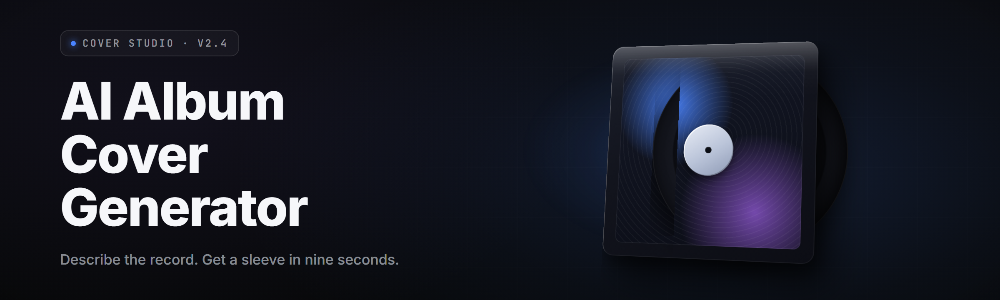

  
  
  

  

  
  

---

**Type a vibe. Get a sleeve. No GPU farm required.**

---

I built this because I got tired of staring at a blank 3000×3000 canvas at 2am with a deadline I'd already blown past. Bandcamp uploads, Spotify canvases, tape dubs, distro splits — every project needed a cover and every cover needed an idea I didn't have. So I wired a diffusion pipeline to a prompt compiler, taught it about typography and bleed margins, and shipped the whole thing as a single `.exe` you drop on the desktop. No Python. No CUDA drivers to hand-compile. No cloud account bleeding your card. Extract it, double-click it, type a phrase like *"smudged oil painting of a drowned cathedral, wet grain, 1990s 4AD sleeve"* and a print-ready 3000×3000 PNG lands in your folder in under forty seconds on a mid-range card.

The AI Album Cover Generator runs offline. Your prompts never leave the box unless you flip the cloud-boost toggle yourself. Every genre preset — vaporwave, black metal, boom-bap, dream pop, dungeon synth, hyperpop, dust-drenched country — is a curated prompt grammar, not a random seed spinner. You get typography controls that respect optical kerning, a sleeve-wrap template for vinyl, and a cassette J-card exporter that actually crops the fold lines right.

## 🧊 Is This The Album Cover Tool You've Been Looking For?

Then grab it.

## 

  

---

## 📚 Table of Contents

- [Overview](#-overview)
- [What is the AI Album Cover Generator?](#-what-is-the-ai-album-cover-generator)
- [The Problem](#-the-problem)
- [The Solution](#-the-solution)
- [Quick Start](#-quick-start)
- [Key Features](#-key-features)
- [Grouped Module Catalog](#-grouped-module-catalog)
  - [🖌️ Prompt & Text Engine](#️-prompt--text-engine)
  - [🎞️ Render Pipeline](#️-render-pipeline)
  - [🔤 Typography & Sleeve Layout](#-typography--sleeve-layout)
  - [📦 Export & Print Prep](#-export--print-prep)
  - [🗂️ Library & Project Management](#️-library--project-management)
  - [⚙️ Runtime & Hardware Backends](#️-runtime--hardware-backends)
- [Comparison — How It Stacks Up](#-comparison--how-it-stacks-up)
- [Compatibility / Platform Support](#-compatibility--platform-support)
- [Installation](#-installation)
- [System Requirements](#-system-requirements)
- [Tips for Best Results](#-tips-for-best-results)
- [Hotkeys](#-hotkeys)
- [All Modules Status](#-all-modules-status)
- [Known Issues](#-known-issues)
- [FAQ](#-faq)
- 

  

(#download)

---

## 🗂️ Overview

| Category | Details |
|---|---|
| Product type | Offline desktop album-art generator (.exe, portable) |
| Core engine | Local latent diffusion, custom SDXL-tuned checkpoint for sleeve art |
| Prompt system | Genre grammar compiler + freeform prompt box |
| Output formats | PNG, TIFF, JPG, PDF sleeve wrap, cassette J-card, CD booklet |
| Max resolution | 4096×4096 native, tile-upscale to 8192 |
| Typography | Built-in optical kerning, letterpress, foil, emboss, hand-scrawl fonts |
| Sleeve presets | 12" LP, 7" single, CD jewel, cassette J-card, digipak, digisleeve |
| Backends | CUDA 12, DirectML (AMD/Intel), CPU fallback |
| Storage per project | ~40 MB (sidecar JSON + variants) |
| Updates | Manual — download the new `.exe`, drop over the old one |

The AI Album Cover Generator is a self-contained Windows desktop app that turns a text prompt and a genre selection into finished, print-ready album artwork. It bundles its own model weights, its own tokenizer, and its own layout engine — no external runtime, no dependency hell. Everything a working musician, label intern, or bedroom producer needs to go from *"I have a sound"* to *"I have a sleeve"* in one sitting.

---

## 🔤 What is the AI Album Cover Generator?

| Term | Explanation |
|---|---|
| **Prompt Grammar** | A structured vocabulary that expands *"dusty lofi"* into a full paragraph of render instructions the model actually understands. |
| **Checkpoint** | The bundled diffusion model file (SDXL-tuned for album art), ~6.4 GB, shipped inside the installer folder. |
| **Sleeve Wrap** | A PDF/PNG template with spine, bleed, and fold lines already marked for physical printing. |
| **J-Card** | The folded paper insert for cassette releases — the app auto-crops the panels so text doesn't land on a crease. |
| **Optical Kerning** | Spacing adjustment that makes letter pairs *look* evenly spaced rather than just measuring evenly. |
| **Sidecar** | A JSON file that stores your prompt, seed, settings, and variant index next to each output image. |
| **Variant Grid** | A 2×2 or 3×3 render pass that produces several interpretations of one prompt at once. |

With the AI Album Cover Generator you can:

- 🎼 Generate a full 2×2 or 3×3 variant grid from one prompt in a single pass
- 🧷 Drop typography directly onto the canvas with bleed-aware placement
- 💾 Keep every prompt, seed, and setting in a sidecar JSON so nothing is lost
- 🖨️ Export ready-to-print sleeve wraps for LP, CD, cassette, and digipak
- 🔒 Run entirely offline — your unreleased album art never touches a server
- 🎚️ Swap between per-genre checkpoints without reinstalling

---

## 🌫️ The Problem

- **Blank-canvas paralysis.** You have the music done but the cover is a wall you keep walking into at 1am.
- **Cloud tools nickel-and-dime you.** Every "AI art" site wants a subscription, a credit pack, or your email before you see a single pixel.
- **Generic art generators don't know what a sleeve is.** They spit out a square image and leave you to figure out bleed, spine width, and fold lines yourself.
- **Typography is an afterthought.** Most generators can't render legible text, let alone kerning that survives a vinyl print.
- **Genre-blind models.** You ask for *black metal* and get *fantasy landscape stock photo*. The vocabulary gap is real.
- **Your unreleased album leaks.** Uploading a prompt to a cloud tool means your cover concept, title, and genre live on someone else's server.
- **Format mismatch.** You need a 12" wrap, not a 1024×1024 Instagram square.

---

## 🧩 The Solution

| Problem | Solution |
|---|---|
| Blank-canvas paralysis | Genre grammar presets that expand one phrase into a full render brief |
| Cloud nickel-and-dime | Fully offline `.exe` — no account, no credits, no subscription |
| No sleeve awareness | Built-in wrap templates for LP, CD, cassette, digipak with bleed + spine |
| Typography afterthought | Native text layer with optical kerning and print-safe placement |
| Genre-blind models | Per-genre checkpoint presets tuned on real fringe-genre sleeve art |
| Concept leakage | Prompt and output never leave the machine unless you opt in |
| Format mismatch | One-click export to any of 6 physical sleeve formats |

---

## ⚡ Quick Start

1. 🎯 **Visit the project page** — read this doc, check the compatibility table, confirm your GPU is listed.
2. 💾 **Download the archive** — single `.zip`, roughly 7.2 GB (weights included). Verify the SHA-256 shown on the landing page.
3. 📂 **Extract** — right-click → *Extract All*. Do **not** run from inside the zip; the model loader needs a real filesystem path.
4. 🖱️ **Run the `.exe`** — double-click, accept the first-run backend probe (takes ~15s), and let it index the bundled checkpoint.
5. 🎨 **Prompt, generate, export** — pick a genre preset, type your phrase, hit *Render*, then *Export Sleeve*.

---

## 🎛️ Key Features

| Feature | Description | Benefit |
|---|---|---|
| Genre Grammar Compiler | Expands shorthand into a structured render brief | You stop guessing what the model needs to hear |
| Variant Grid | 2×2 / 3×3 interpretations per prompt | Pick the winner, don't re-roll blind |
| Sleeve Wrap Templates | LP, 7", CD, cassette, digipak, digisleeve | Print-ready first time, no manual bleed math |
| Native Text Layer | Typography on top of the render, not painted in | Legible titles at any size |
| Optical Kerning | Letter-spacing that looks right, not just measures right | Titles that survive a physical print |
| Per-Genre Checkpoints | Model presets for metal, lofi, vaporwave, etc. | Vocab that lands in the right visual space |
| Sidecar JSON | Every render stores its recipe | Reproduce any image exactly |
| Offline-First | No network call required for generation | Unreleased work stays unreleased |
| Batch Queue | Line up 25 prompts and walk away | Overnight sleeve passes |
| Upscale Pass | 4096 → 8192 tile upscale | Poster and gatefold grade output |
| Foil / Emboss FX | Print-effect simulation layer | Mockups that look like the finished record |
| Color Harmony Lock | Constrain palette across a multi-cover release | A catalogue that actually looks like a catalogue |

---

## 🧱 Grouped Module Catalog

### 🖌️ Prompt & Text Engine

| Feature | Effect |
|---|---|
| Shorthand Expander | Turns *"dusty lofi"* into a full 90-word brief |
| Genre Preset Bank | 40+ curated genre grammars |
| Negative Prompt Panel | Explicit things the model should avoid |
| Seed Lock / Randomize | Reproduce or reroll deterministically |
| Prompt History | Last 500 prompts searchable |
| Tag Autocomplete | Suggests sleeve-native vocabulary as you type |

### 🎞️ Render Pipeline

| Feature | Effect |
|---|---|
| SDXL-Tuned Checkpoint | Sleeve-grade output at native 1024 base |
| Variant Grid Pass | 4 or 9 images from one prompt |
| Tile Upscale | 4096 → 8192 without seams |
| Refiner Stage | Second-pass detail on the chosen variant |
| LoRA Slot | Drop in your own style LoRA |
| Runtime Backend Probe | Auto-picks CUDA / DirectML / CPU |

### 🔤 Typography & Sleeve Layout

| Feature | Effect |
|---|---|
| Optical Kerning Engine | Letter pairs spaced by eye, not by number |
| 60+ Bundled Fonts | Serif, blackletter, grotesk, hand-scrawl |
| Text-on-Path | Curved and rotated titles |
| Foil / Emboss Simulation | Metallic and raised-type mockups |
| Sleeve Bleed Guides | Visual safe-area overlay |
| Spine Text Auto-Fit | Squeezes artist/title onto the spine cleanly |

### 📦 Export & Print Prep

| Feature | Effect |
|---|---|
| LP Wrap Export | 12" with spine, bleed, crop marks |
| 7" Single Export | Small-format wrap |
| CD Booklet Export | 4-panel booklet PDF |
| Cassette J-Card Export | Fold-aware panel cropping |
| Digipak Export | Multi-panel gatefold |
| TIFF / PDF / PNG | Choose your printer's format |

### 🗂️ Library & Project Management

| Feature | Effect |
|---|---|
| Project Browser | Grid view of every sleeve you've made |
| Sidecar Recipes | Every image carries its own build sheet |
| Tag & Search | Find that one cover from March |
| Variant Compare | Side-by-side A/B on the canvas |
| Trash & Restore | Soft-delete with 30-day restore |
| Project Archive | Zip a whole release folder |

### ⚙️ Runtime & Hardware Backends

| Feature | Effect |
|---|---|
| CUDA Backend | Fastest path on NVIDIA 20-series+ |
| DirectML Backend | AMD and Intel GPU support |
| CPU Fallback | Slow but always works |
| VRAM Manager | Aggressive offload for 6 GB cards |
| Model Loader | Indexes the bundled checkpoint on first run |
| Safe-Mode Boot | Skips GPU probe if a driver crashes |

---

## ⚖️ Comparison — How It Stacks Up

| Aspect | Cloud AI Art Tools | Generic Local Generators | This Tool |
|---|---|---|---|
| Cost model | Subscription / credits | Free but DIY | One download, no account |
| Album-sleeve awareness | None | None | Built-in wrap templates |
| Typography | Prompt-hoped | Prompt-hoped | Native text layer with kerning |
| Privacy | Prompt leaves your machine | Local | Local, offline-first |
| Genre vocabulary | Generic | Generic | 40+ curated genres |
| Print-ready output | No | Manual | One-click sleeve export |
| Setup friction | Sign up | Python + CUDA + deps | Extract and run the `.exe` |

---

## 🖥️ Compatibility / Platform Support

| Platform | Status | Notes |
|---|---|---|
| Windows 11 (x64) | ✅ Full | Recommended |
| Windows 10 22H2 (x64) | ✅ Full | Fully supported |
| Windows 10 (older builds) | ⚠️ Partial | DirectML backend recommended |
| NVIDIA RTX 20/30/40 | ✅ Full | CUDA 12 backend |
| AMD RX 6000/7000 | ✅ Full | DirectML backend |
| Intel Arc A-series | ✅ Full | DirectML backend |
| Intel UHD iGPU | ⚠️ Slow | Works, minutes per image |
| CPU-only | ✅ Works | Very slow, no GPU required |
| Linux / macOS | ❌ Not supported | Windows-only build |

---

## 📥 Installation

1. **Download and verify.** Grab the archive from the project landing page. Compare the SHA-256 hash printed there against the file you saved — if it doesn't match, re-download before extracting.
2. **Extract to a real folder.** Right-click → *Extract All* to something like `C:\AlbumCoverGen`. Do not run the `.exe` from inside the zip; the model loader needs a proper filesystem path and will refuse a virtual one.
3. **Run and let it probe.** Double-click the `.exe`. First launch runs a one-time hardware probe (~15 seconds) and indexes the bundled checkpoint. If a GPU driver crashes during the probe, launch with *Safe-Mode Boot* from the same menu.

---

## 🧮 System Requirements

| Component | Minimum | Recommended |
|---|---|---|
| OS | Windows 10 22H2 x64 | Windows 11 x64 |
| CPU | 4-core / 8-thread | 8-core / 16-thread |
| RAM | 16 GB | 32 GB |
| GPU VRAM | 6 GB | 12 GB+ |
| Storage | 12 GB free (app + weights) | 40 GB free (project library) |
| Display | 1920×1080 | 2560×1440 |
| Runtime | Bundled — nothing to install | — |

---

## 🎯 Tips for Best Results

- Describe **material and era**, not just subject: *"scratched 1994 jewel case scan"* beats *"cool cover."*
- Give the model a **palette anchor** — *"two-color risograph, black and blood orange"* locks the mood.
- Keep the **prompt under 60 words** unless you're using a genre preset; long freeform prompts dilute.
- Render a **variant grid first**, then refine only the winning square — saves VRAM and time.
- Add titles in the **native text layer**, never in the prompt — diffusion text is mush.
- Set the **seed lock** once you find a composition you like and iterate the palette from there.
- Use **color harmony lock** across an EP or album so the whole release reads as one object.
- Upscale **after** picking the final variant, not before — upscaling a loser wastes minutes.

---

## ⌨️ Hotkeys

| Key | Action |
|---|---|
| `Ctrl + Enter` | Render current prompt |
| `Ctrl + Shift + Enter` | Render 2×2 variant grid |
| `Ctrl + S` | Save project + sidecar |
| `Ctrl + E` | Export sleeve wrap |
| `Ctrl + T` | Focus the text layer |
| `Ctrl + K` | Toggle kerning guides |
| `F2` | Safe-Mode Boot on next launch |

---

## 🧾 All Modules Status

| Module | Status | Description |
|---|---|---|
| Prompt Grammar Compiler | ✅ Working | Shorthand → structured brief expansion |
| Genre Preset Bank | ✅ Working | 40+ curated genre grammars |
| Variant Grid Renderer | ✅ Working | 2×2 and 3×3 output passes |
| Tile Upscaler | ✅ Working | 4096 → 8192 seamless |
| Text Layer | ✅ Working | Native typography over renders |
| Optical Kerning Engine | ✅ Working | Print-grade letter spacing |
| Sleeve Wrap Exports | ✅ Working | LP / 7" / CD / cassette / digipak |
| J-Card Cropper | ✅ Working | Fold-aware cassette panel cropping |
| Sidecar Recipes | ✅ Working | Per-image JSON build sheets |
| GPU Backend Probes | ✅ Working | CUDA / DirectML / CPU auto-select |
| LoRA Slot | ✅ Working | User-style LoRA loading |
| Refiner Stage | ✅ Working | Second-pass detail on chosen variant |
| Color Harmony Lock | ✅ Working | Palette constraint across projects |
| Project Archive | ✅ Working | Zip a release folder |
| Foil / Emboss FX | 🟡 Beta | Mockup effects still being tuned |
| Batch Queue | ✅ Working | Line up 25+ prompts |
| Safe-Mode Boot | ✅ Working | Driver-crash fallback path |
| Font Pack | ✅ Working | 60+ bundled faces |

---

## 🐞 Known Issues

| Issue | Solution |
|---|---|
| First run says *"checkpoint not indexed"* | Let the initial probe finish completely; don't close the window |
| DirectML render is slow on Intel UHD | Expected — switch to a discrete GPU or reduce resolution |
| Text looks fuzzy in the mockup but fine on export | Preview is downscaled; trust the exported sleeve |
| `Ctrl+Enter` does nothing | Click into the prompt box first so it has focus |
| ZIP won't extract fully | Use Windows' built-in extractor, not a browser's inline preview |
| App closes during render on 6 GB card | Enable VRAM Manager in Settings → Runtime |

---

## 💬 FAQ

**Q:** Is this safe to run on my machine?
**A:** It's an offline `.exe` with no network calls during generation. It doesn't phone home, doesn't upload prompts, and doesn't install a background service. Scan it with whatever you trust, then run it.

**Q:** Do I need Python or a CUDA toolkit installed?
**A:** No. Everything is bundled inside the folder you extract. The `.exe` ships with its own runtime, model loader, and backend selector.

**Q:** Does it work without a GPU?
**A:** Yes — CPU fallback is supported. Expect minutes per image instead of seconds. Reduce resolution to 1024 base for tolerable speed.

**Q:** Can I use my own style checkpoint or LoRA?
**A:** Yes. Drop the file into the `models/` folder next to the `.exe` and it appears in the LoRA Slot dropdown on next launch.

**Q:** Will it make text look right on the cover?
**A:** Only the native text layer renders legible type. Never rely on the diffusion model to draw your album title — it will produce mush. Add titles with the text layer after the render.

**Q:** How big are the output files?
**A:** A 3000×3000 PNG is roughly 8–14 MB. The sidecar JSON is tiny — a few KB. A full release archive zips to a few hundred MB.

**Q:** Can I sell covers I make with this?
**A:** Check the license badge at the top of this page. The app is MIT; the bundled checkpoint carries its own license terms listed in `LICENSES.txt` inside the extract folder. Read both before commercial use.

**Q:** Does it support AMD or Intel GPUs?
**A:** Yes, via the DirectML backend. NVIDIA cards get the faster CUDA path, but AMD RX and Intel Arc are fully supported.

**Q:** Will my prompts or images ever be uploaded anywhere?
**A:** No. Generation is entirely local. There's an optional cloud-boost toggle you must turn on yourself, and it's off by default.

**Q:** How do I update the app?
**A:** Download the newer `.exe` from the landing page, drop it over the old one, and keep your project folder untouched. Model weights rarely change between minor versions.

**Q:** What happens if I delete a project by accident?
**A:** Projects go to a soft-delete trash with a 30-day restore window. After 30 days they're gone for good.

---

## 

  

---

*The AI Album Cover Generator exists because the gap between "I have a sound" and "I have a sleeve" was too wide for too long. It runs on your machine, respects your unreleased work, and treats an album cover like the physical object it's meant to become — bleed, spine, fold lines and all. Extract it, prompt the thing, and print something you'd actually hand to someone.*
